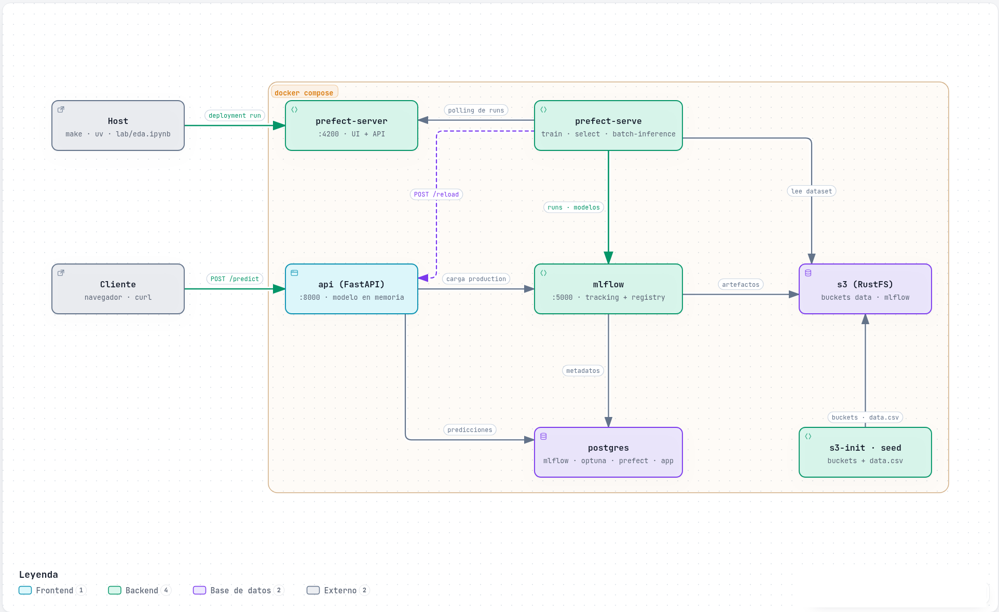
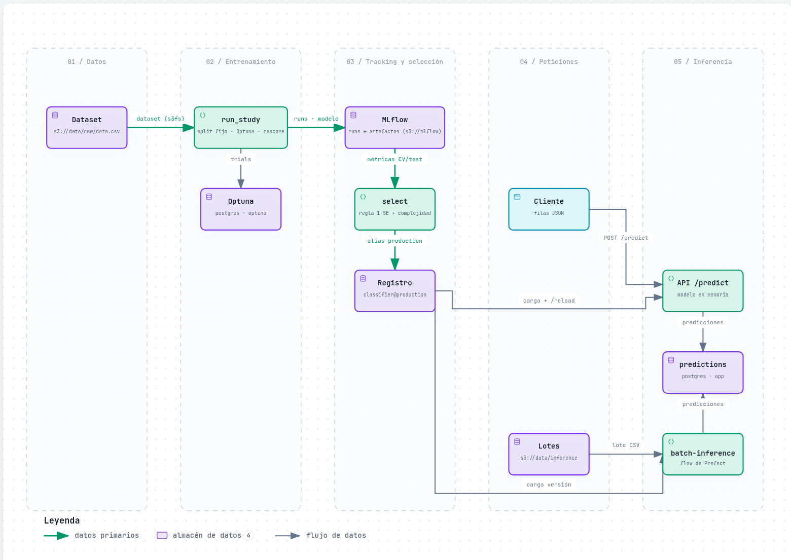
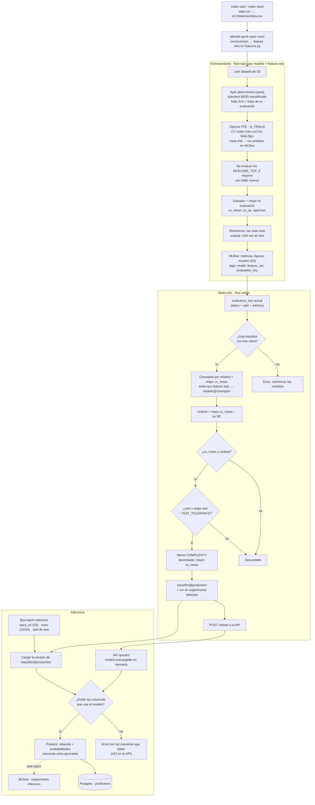

# ML Platform

Plataforma local de ML: entrenamiento con búsqueda de hiperparámetros, selección y promoción de un modelo a producción, e inferencia batch con las predicciones guardadas en Postgres.

| Pieza | Herramienta |
| --- | --- |
| Orquestación | Prefect |
| Tracking y registro de modelos | MLflow |
| Búsqueda de hiperparámetros | Optuna |
| Almacenamiento de datos y artefactos | S3 (RustFS) |
| Predicciones, metadatos de MLflow, Optuna y Prefect | Postgres |

Todo se levanta con docker compose.

## Inicio rápido

Requisitos: Docker con Compose v2. Para el notebook y los tests, también [uv](https://docs.astral.sh/uv/).

```bash
make start            # levanta los servicios y sube data.csv a s3://data/raw/
make train-select     # entrena los 5 modelos (30 trials) y promueve el mejor (~10 min)
make infer            # predice con el modelo de producción y guarda en Postgres
```

| Servicio | URL | Credenciales |
| --- | --- | --- |
| Prefect (lanzar y seguir flows) | `http://localhost:4200` | |
| API de inferencia online: página de prueba en `/`, docs en `/docs` | `http://localhost:8000` | |
| MLflow (experimentos y modelos) | `http://localhost:5000` | |
| Consola S3 (datos y artefactos) | `http://localhost:9101/rustfs/console` | `s3admin` / `s3admin12345` |
| Postgres | `localhost:5432` | `mlp` / `mlp`; bases `app`, `mlflow`, `optuna`, `prefect` |

## Comandos

```bash
make start                               # servicios + dataset en S3 (idempotente)
make seed                                # vuelve a subir data.csv a s3://data/raw/data.csv
make train MODELS=svm,logreg TRIALS=10   # estudios de Optuna; sin MODELS entrena todos, sin TRIALS usa 30
make train FEATURES=with_flat_columns    # mismo entrenamiento con otro feature set (por defecto eda_minimal)
make select                              # champion por modelo y modelo de producción
make train-select                        # train + select en un paso (admite los mismos parametros que train)
make infer                               # lote por defecto: el split de test
make infer INPUT=s3://data/inference/lote.csv
make infer ROWS='[{"Timestamp": "2025-04-10 12:00:00", "F22": 18.5, "F17": null}]'   # filas sueltas, sin S3
make eda                                 # re-ejecuta lab/eda.ipynb (desde el host)
make test                                # tests unitarios
make stop                                # para los servicios
make clean                               # para y borra los volúmenes (datos, runs, modelos)
```

Los comandos `train`, `select` e `infer` lanzan el deployment de Prefect y esperan a que termine. También se pueden lanzar desde la UI de Prefect (*Deployments*). El reentrenamiento diario (`train-and-select`, 03:00) está definido pero desactivado: se activa desde la UI.

Para subir un lote de inferencia: `uv run python -m mlplatform.storage upload lote.csv s3://data/inference/lote.csv`. El lote solo necesita las columnas que usa el modelo de producción; cualquier otra (incluida `Target`) se ignora.

Para predecir unas pocas filas sin subir un CSV, se pasan en JSON con `ROWS` (también desde la UI de Prefect, parámetro `rows`). Cada fila debe incluir las columnas del feature set del modelo de producción; si falta alguna, la predicción falla indicando cuáles. Estas predicciones se guardan igual que las de un lote, con `input_uri = 'inline'`. No es inferencia en tiempo real: cada llamada crea un flow run y carga el modelo, unos segundos.

## Arquitectura



Servicios de docker compose y cómo se comunican: Prefect ejecuta los flows, MLflow guarda runs y modelos (metadatos en Postgres, artefactos en S3), la API sirve el modelo de producción en memoria y todas las predicciones acaban en Postgres.



Recorrido de los datos desde el dataset en S3 hasta las predicciones: entrenamiento con Optuna, tracking en MLflow, selección del modelo de producción e inferencia por lotes o por la API.

Las versiones interactivas (zoom, búsqueda, tema oscuro, exportación a SVG/PNG) están en [`diagrams/platform-architecture.html`](diagrams/platform-architecture.html) y [`diagrams/ml-dataflow.html`](diagrams/ml-dataflow.html); se abren directamente en el navegador. Se generan con Archify.
## Flujo

```plain
lab/eda.ipynb          EDA sobre train → decisiones de features
features.py            feature sets con nombre (inmutables) y su preprocesado
models/<modelo>.py     pipeline (preprocesado + estimador) + espacio de búsqueda
tuning.py              Optuna con split y folds fijos → MLflow
selection.py           champion por modelo → producción (regla 1-SE + complejidad)
inference.py           lote de S3 → classifier@production → Postgres
api.py                 API online con classifier@production en memoria → Postgres
flows.py               flows de Prefect sobre las piezas anteriores
```



El núcleo es Python plano y no depende de Prefect. Para pruebas rápidas desde el host (con los servicios levantados):

```bash
uv run --env-file .env python -m mlplatform.tuning svm --features reduced_set --trials 5
uv run --env-file .env python -m mlplatform.selection
uv run --env-file .env python -m mlplatform.inference [s3://data/inference/lote.csv]
uv run --env-file .env python -m mlplatform.inference --rows '[{"Timestamp": "2025-04-10 12:00:00", "F22": 18.5}]'
```

`--env-file .env` es necesario para la inferencia. Lo que pueda acabar en producción conviene entrenarlo por Prefect, que usa el mismo código que luego sirve el modelo.

### 1. EDA

`lab/eda.ipynb` lee el dataset de S3 y analiza **solo el split de train**, para no tomar decisiones viendo el test. Cubre calidad de datos, balance, columnas planas, relación con el target (mutual information, V de Cramér corregida), correlaciones, cardinalidad, features de fecha y una ablación con los folds del proyecto.

Figuras, tablas y conclusiones se registran en MLflow (experimento `eda`). La sección 9 del notebook recoge las decisiones que implementa `features.py`.

### 2. Features

Resultado del analisis exploratorio, si detectamos data skews o decremento del modelo de produccion con el tiempo, debemos rehacer el analisis y sacar nuevas conclusiones si es necesario y aplicarlas en `features.py` como un feature set nuevo para el entrenamiento.

Un **feature set** es una función de `features.py` decorada con `@feature_set` que devuelve un `ColumnTransformer` de scikit-learn: decide qué columnas entran y cómo se limpian y codifican, con cualquier paso estándar (imputación por media o mediana, discretización, encoders…). Su docstring es su descripción y sus columnas de entrada se leen del propio transformer. Es **inmutable**: una vez se ha entrenado un modelo con él, no se edita; para probar otro preprocesado se añade uno nuevo. Es una regla de trabajo, no una comprobación automática: editar un feature set ya usado cambiaría en silencio los modelos que dependen de él.

| Feature set | Columnas |
| --- | --- |
| `eda_minimal` (por defecto) | Decisiones del EDA: mes, `F22`, `F17` |
| `with_flat_columns` | `eda_minimal` + las 8 columnas planas que el EDA descartó (F3, F6, F9, F12, F18, F21, F24, F27) |
| `reduced_set` | `eda_minimal` sin `F17` |

Tratamiento en `eda_minimal`:

| Feature | Tratamiento | Por qué |
| --- | --- | --- |
| `month` (de `Timestamp`) | One-hot; nulo → categoría `missing` | Determina casi por completo el target (V de Cramér 0,95). One-hot para no asumir orden entre meses |
| `F22` | Imputación por mediana | Única numérica con señal fuerte (MI 0,76) |
| `F17` | Mediana + indicador de nulo | 90 % nulos; el valor informa cuando está |

Los pasos que dependen del algoritmo no van en el feature set sino en el módulo del modelo: logreg, SVM y MLP añaden un `StandardScaler` después del feature set; random forest y XGBoost no escalan.

Un modelo se entrena **solo con las columnas de su feature set**. En inferencia, las columnas extra o ausentes que el modelo no usa se ignoran; si falta una que sí usa, la predicción falla con un error explícito en lugar de inventar valores.

**Añadir un feature set**: escribir en `features.py` una función con nombre descriptivo, decorada con `@feature_set`, que devuelva `columns(...)` (o cualquier `ColumnTransformer`). Las piezas `columns()` y `month_onehot()` cubren lo habitual. Por ejemplo, imputar `F22` con la media:

```python
@feature_set
def eda_minimal_mean() -> ColumnTransformer:
    """eda_minimal imputing F22 with the mean."""
    return columns(
        ("month", month_onehot(), [TIMESTAMP]),
        ("strong", SimpleImputer(strategy="mean"), ["F22"]),
        ("sparse", SimpleImputer(strategy="median", add_indicator=True), ["F17"]),
    )
```

### 3. Modelos

Cada modelo es un módulo en `src/mlplatform/models/` con el mismo contrato:

```python
NAME = "svm"
COMPLEXITY = 2                            # orden de simplicidad y explicabilidad

def suggest(trial) -> dict: ...           # espacio de búsqueda de Optuna
def build_pipeline(params, features) -> Pipeline: ...  # feature set (+ escalado si el modelo lo necesita) + estimador
```

| Modelo | Complejidad | Notas |
| --- | --- | --- |
| `logreg` | 1 | |
| `svm` | 2 | Kernel RBF |
| `random_forest` | 3 | |
| `xgboost` | 3 | Envoltorio que codifica las etiquetas |
| `mlp` | 4 | Red PyTorch propia: capas, activación y dropout se buscan; early stopping y pérdida por época |

**Añadir un modelo**: crear `models/<nombre>.py` con ese contrato y añadirlo al diccionario `MODELS` de `models/__init__.py`.

### 4. Tuning

`tuning.run_study(modelo, feature_set)` es igual para todos los modelos:

1. Lee el dataset de S3 y genera el split (80/20 estratificado) y los folds (5×2 estratificados repetidos). Son deterministas: todos los modelos usan exactamente los mismos índices.
2. Optuna (TPE) maximiza el F1 macro medio en CV sobre train.
3. **Re-evaluación**: los `RESCORE_TOP_K` (5) mejores trials se vuelven a puntuar con una partición distinta de los mismos datos de train (otra seed), que no participó en la búsqueda. Gana el de mejor re-evaluación, y su media es el `cv_mean` que usa la selección. Así la medida no arrastra la suerte de los folds con los que se eligió el trial.
4. El ganador se reentrena con todo train y se evalúa **una vez** en test.

### 5. Selección

Solo compiten los estudios con la **clave de evaluación** actual: mismos datos, mismo split y folds (seed, tamaños) y misma métrica. El feature set y el código no forman parte de la clave: son lo que se compara. Si cambian los datos o el split, hay que reentrenar todos los modelos antes de seleccionar.

1. **Champion por modelo**: su estudio con mejor CV, sea cual sea el feature set, registrado como `<modelo>@champion`.
2. **Producción**, regla de 1 error estándar: se toma el champion con mejor CV y se consideran empatados todos los que estén a menos de 1 SE de él. De ellos gana el de menor complejidad, y luego el de mayor CV.
3. **Control en test**: se descarta un candidato que quede más de `TEST_TOLERANCE` (0,05) por debajo del mejor test. El test no elige, solo controla: con 100 filas, un error equivale a un punto.
4. El ganador se registra como `classifier@production`. Volver a ejecutar la selección no crea versiones si nada cambió.

### 6. Inferencia

`inference.batch_inference(input_uri)` resuelve `classifier@production`, carga esa versión desde S3 en memoria, predice y guarda una fila por predicción:

| Columna | Contenido |
| --- | --- |
| `prediction_id`, `timestamp`, `predicted_value` | Base |
| `probabilities` | Probabilidad por clase (JSONB) |
| `model_name`, `model_version`, `model_family`, `feature_set`, `run_id` | Qué modelo predijo |
| `batch_id`, `input_uri` | De qué lote viene (`inline` si las filas se pasaron directamente, `api` si llegaron por la API) |
| `features` | Valores de entrada que usó el modelo (JSONB) |

```bash
docker compose exec postgres psql -U mlp -d app -c "select prediction_id, timestamp, predicted_value, model_family, model_version from predictions limit 5"
```

### 7. API online

El servicio `api` (FastAPI) carga `classifier@production` **una vez al arrancar** y lo mantiene en memoria, así que cada predicción tarda milisegundos (unos 0,1 s, escritura en Postgres incluida). Cada predicción se guarda en `predictions` con `input_uri = 'api'`.

| Endpoint | Uso |
| --- | --- |
| `POST /predict` | Predice una o varias filas: `{"rows": [{...}, ...]}`. Devuelve etiqueta, probabilidades y el modelo usado |
| `GET /` | Página HTML para probar `/predict`: muestra el modelo en producción y acepta un formulario con sus columnas o una lista de filas en JSON |
| `GET /health` | Estado, modelo cargado y columnas que necesita |
| `POST /reload` | Vuelve a cargar `classifier@production`. El flow `select` lo llama solo tras cada selección |

```bash
curl -s localhost:8000/health
curl -s -X POST localhost:8000/predict -H 'Content-Type: application/json' \
  -d '{"rows": [{"Timestamp": "2025-07-20 10:00:00", "F22": 30.0, "F17": null}]}'
```

El ejemplo vale para un modelo con `eda_minimal`. Las filas deben incluir las columnas que indica `/health` (`required_columns`); si falta alguna responde 422 con la lista. Si no hay modelo de producción, la API arranca igualmente y responde 503 hasta que una selección lo promueva. A diferencia de la inferencia batch, la API no registra cada petición en MLflow: solo en Postgres.

## Dónde mirar los resultados

### MLflow

| Experimento | Contenido |
| --- | --- |
| `eda` | Figuras, tablas y `conclusions.json` del notebook |
| `tuning` | Un run padre por modelo y feature set (`svm/eda_minimal`) con trials anidados (`svm/eda_minimal/trial-012`) y el reentrenamiento final (`svm/eda_minimal/final`) |
| `selection` | Un run por selección (`production-svm`) con los champions, todos los estudios comparables y el umbral 1-SE |
| `inference` | Un run por lote (`batch-1a2b3c4d`) con recuento por clase y confianza media |

En `tuning`, la tabla de runs padre compara de un vistazo `cv_mean`, `cv_se`, `test_f1_macro`, `fit_seconds` y `complexity`. `search_cv_mean` es la puntuación del trial en la búsqueda y `optimism` cuánto pierde el mejor trial de la búsqueda al re-evaluarlo: mide el sesgo de selección. La tabla `rescore.json` del padre muestra la re-evaluación de los mejores trials. Cada run `final` incluye matriz de confusión, reporte por clase, importancia por permutación y el modelo; el MLP añade su curva de pérdida. El padre incluye los gráficos de Optuna y los índices del split.

Modelos registrados: `logreg`, `svm`, `random_forest`, `xgboost`, `mlp` (alias `champion`) y `classifier` (alias `production`).

### S3

| Ruta | Contenido |
| --- | --- |
| `s3://data/raw/data.csv` | Dataset original |
| `s3://data/inference/` | Lotes de inferencia |
| `s3://mlflow/` | Todos los artefactos de MLflow, modelos incluidos |

Nada se guarda en disco local. MLflow solo descarga los modelos a un directorio temporal al cargarlos.

## Configuración

`src/mlplatform/config.py` (pydantic-settings) centraliza los valores globales. Cada uno se cambia con una variable de entorno del mismo nombre en mayúsculas, o en `.env`, que leen tanto el host como los contenedores.

| Variable | Defecto | Uso |
| --- | --- | --- |
| `DATA_URI` | `s3://data/raw/data.csv` | Dataset |
| `TARGET` | `Target` | Columna objetivo |
| `SEED` | 42 | Split, folds, Optuna y modelos |
| `TEST_SIZE`, `N_SPLITS`, `N_REPEATS` | 0,2 / 5 / 2 | Validación |
| `METRIC` | `f1_macro` | Cualquier scorer de sklearn |
| `N_TRIALS` | 30 | Trials por modelo |
| `RESCORE_TOP_K` | 5 | Mejores trials que se re-evalúan con folds nuevos |
| `TEST_TOLERANCE` | 0,05 | Control en test de la selección |

Los hiperparámetros no van aquí: viven en cada módulo de modelo. `DATA_URI`, `TARGET`, `SEED`, la validación y `METRIC` forman la clave de evaluación: cambiarlos (o cambiar el dataset) obliga a reentrenar todos los modelos.

## Estructura

```plain
├── diagrams/          diagramas de arquitectura (.json fuente, .html interactivo, assets/ PNG)
├── lab/eda.ipynb
├── src/mlplatform/
│   ├── config.py      data.py      features.py
│   ├── models/        logreg.py  svm.py  random_forest.py  xgboost.py  mlp.py
│   ├── tuning.py      selection.py   inference.py   api.py   reporting.py
│   ├── storage.py     (buckets y subida a S3)
│   └── flows.py       (Prefect)
├── tests/
└── docker-compose.yml   Dockerfile   Makefile   .env
```

## Hallazgos y limitaciones

- **El mes explica el target**: enero → A, abril → B, julio → C, octubre → D. El split aleatorio estratificado mide interpolación: asume datos nuevos de esos mismos periodos. Un split temporal no es viable porque dejaría la clase D (solo octubre) fuera del entrenamiento.
- **≈6 % de filas fuera de patrón**: `F22` es la única pista para ellas.
- **Re-evaluación con los mismos datos**: Se evaluan los modelos con folds nuevos que reparten las mismas 400 filas de otra forma. Eliminan la suerte de la partición, no la de la muestra; para eso sigue estando el test.
- **Inferencia batch sin modelo residente**: los flows de inferencia cargan el modelo una vez por lote. Para predicciones online de baja latencia está la API, que lo mantiene en memoria.
- **Entrenamiento secuencial**: los estudios se ejecutan uno tras otro. Se pueden hacer como flujos paralelos tipo map en el entrenamiento y reduce en la seleccion, esto seria mas rapido pero consumiria mas recursos, para pruebas en local mejor secuencial

## Escalado a cloud

| Local | Cloud |
| --- | --- |
| RustFS | S3 / GCS |
| Postgres | RDS / Cloud SQL |
| MLflow | Contenedor gestionado (ECS/Cloud Run) o MLflow gestionado, con backend en RDS |
| Prefect server + serve | Prefect Cloud o servidor propio, con work pools de Kubernetes/ECS: un contenedor por flow run |
| Estudios de Optuna | Trials en paralelo en varios workers que comparten el storage en Postgres |
| Inferencia | Flow batch programado; la API en un servicio con autoscaling (ECS/Cloud Run/Kubernetes) detrás de un balanceador. Con varias réplicas, `/reload` se sustituye por un despliegue progresivo o por que cada réplica consulte el alias periódicamente |
| Infraestructura | Terraform; imágenes en un registry; CI con tests y despliegue |
